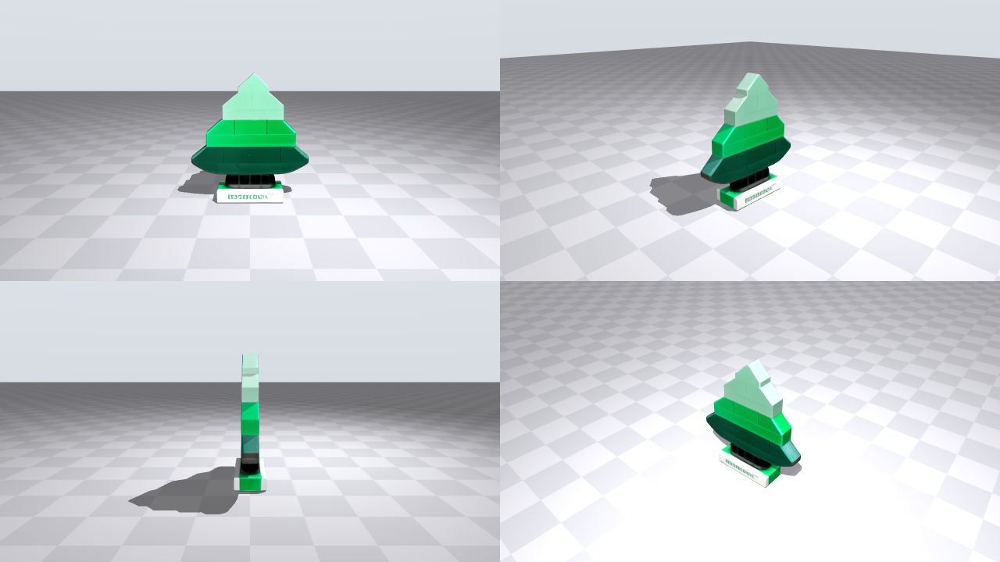

# Photo2Grasp

**From phone photos of a real object to a robot arm that picks it up, trained only in simulation.**

Take a few photos of an object (or a video of a table scene). Photo2Grasp turns it into a simulation-ready
MuJoCo object with real size, mass and friction, trains a pick-up policy for the low-cost **SO-100** arm
entirely in simulation, and runs that policy on the real arm with no real-world training data.



## How it works

```
photos ─► TRELLIS 3D mesh ─► clean + straighten + scale to real size ─► CoACD collision shapes
       ─► mass / inertia / friction ─► MuJoCo asset ─► SO-100 training scene
                                                            │
             reinforcement learning in simulation (SAC) ◄───┘
                                │
                                ▼
   real SO-100: webcam ─► AprilTag ─► object position ─► policy ─► joint commands
```

**1. Photos → MuJoCo object** (`make_asset.py`, `pipeline/`)
- 3D mesh from one or more photos with **TRELLIS** (Hugging Face Space), at the most detailed settings the
  Space allows.
- Texture repainted from the real photos (`pipeline/texture_projection.py`): each photo is registered to
  the mesh and its pixels replace TRELLIS's re-drawn colours wherever it sees the surface head-on, so label
  text stays readable. Surface no photo saw keeps the TRELLIS colours.
- Generic mesh cleanup, no per-object tweaks: background removal, stable resting pose, real-world size,
  mass from density x volume, textured visual mesh.
- Collision: cans, bottles and boxes get one primitive (`"collision": "cylinder"` or `"box"`) at the measured
  size, the exact contact surface. Everything else gets a fine CoACD decomposition of the full-resolution
  mesh (`coacd_threshold`, `max_convex_hulls` per object to trade accuracy for simulation speed).
- `properties.json` reports how far the collision surface strays from the object surface (overshoot and
  undershoot in mm), and `preview.png` shows the asset in MuJoCo: visual mesh on top, collision below.
- Real size, mass and friction come from known data (`objects.json`) with the source written down. Give
  `size_m` (all three dimensions) rather than `height_m`, so width and depth are right too.

**2. Video of a table → MuJoCo scene** (`scene/`)
- COLMAP camera poses and point cloud from a phone video.
- Finds the table plane and metric scale from the table's real size, then every object standing on it.
- Builds each object with TRELLIS and places the table, objects and SO-100 in one MuJoCo scene.

**Scene API** (`api/`): the video pipeline as an HTTP service, with the hand-written `info.json` replaced
by Gemini and web search. One background job per video, in `outputs/jobs/<id>/`:

```
reconstruct ─► find_objects ─► object_views ─► identify ─► reference_images ─► physics ─► build ─► render
  (COLMAP)     (table, scale,   (best crops)    (Gemini:     (Google Images via    (Gemini +    (TRELLIS   (MuJoCo
                positions)                       what is it)  SerpAPI, Gemini      Google Search: + MJCF)    renders)
                                                              keeps exact matches)  size, mass, friction)
```

- Web product photos go to TRELLIS together with the video crops, and also repaint the texture, so labels
  come out sharper than the video alone allows.
- A looked-up height that differs from the scanned height by more than 25 % is ignored and the scan is used.
- With `review=true` the job pauses after the physics lookup. Correct an object with `PATCH`, then resume.

```bash
.venv/bin/python -m uvicorn api.server:app --port 8000          # docs at http://localhost:8000/docs
curl -F video=@table.mp4 -F table_length_cm=180 -F table_width_cm=75 -F table_height_cm=74 -F review=true \
     localhost:8000/jobs                                         # -> {"id": ...}
curl localhost:8000/jobs/<id>                                    # status, stage, objects found so far
curl -X PATCH localhost:8000/jobs/<id>/objects/object_0 -H 'content-type: application/json' \
     -d '{"physics": {"mass_kg": 0.35, "friction": 0.5}}'
curl -X POST "localhost:8000/jobs/<id>/run?from_stage=build"     # resume (or rerun any finished stage)
curl -o scene.zip localhost:8000/jobs/<id>/scene.zip             # layout + renders + MuJoCo assets
.venv/bin/python -m api.run table.mp4 --table 180 75 74          # the same stages, in the foreground
```

**3. Simulation training, AprilTag tracking** (`sim2real/`)
- The policy never sees images. It gets joint angles plus the object's position from an **AprilTag** on the
  object, so lighting and background differences between sim and reality don't matter.
- The tag detection is simulated the way the real robot does it:
  - project the tag into a randomized webcam;
  - keep it only if it would really be detected (in view, large enough, not too slanted, not hidden by the
    gripper);
  - add pixel noise and missed frames;
  - solve its pose with OpenCV (`solvePnP`) using the nominal lens and camera mount.
  So camera, mount and calibration errors on the real robot are already part of training.
- Two cameras: a webcam on the gripper (tag on the front of the object) and a fixed webcam across the
  table (tag on the back, which the arm never blocks).
- Before each attempt the arm holds a "look" pose and scans left/right/up/down until it finds the tag.
  Afterwards it tracks the tag live, 10 times a second.
- Domain randomization: object position and angle, mass, friction, motor strength, camera mounts and
  lenses, joint-reading noise.
- Small MLP policies trained with SAC and an asymmetric critic (the critic sees the true object state during
  training only). Trains on a CPU or a free Colab T4, no rendering needed.

**4. Real SO-100** (`robot/`)
- Motor ID setup and calibration following LeRobot's procedure, with the MuJoCo arm shown alongside.
- Digital twin (torque off): the real arm drives the sim.
- Runs the trained policy with slow, speed-limited moves: zero pose → look pose → scan → pick up.

## Results (simulation)

AprilTag lift policy, 2M training steps, 200 test attempts with random placement and randomization:

| Outcome | Share |
|---|---|
| Picked up and lifted 5 cm, upright | **87.5%** |
| Knocked the object over | 10% |
| Missed the grasp | 2.5% |

`runs/tag_envcam_2250k/actor_last.pt` (wrist + environment camera) picks the Lego tree up on the real SO-100.

## The pipeline: one command, step by step

| Step | Command | What happens |
|---|---|---|
| 1. Object | `python photo2grasp.py asset celsius_can inputs\can_1.mp4 inputs\can_2.mp4` | Any number of videos or photos. The best 4 frames are picked by fixed rules (sharp, whole object, different sides). Real size, mass and friction come from `objects.json`, or you are asked (optional `--claude`: Claude looks them up online through the Anthropic API). TRELLIS builds the mesh, then cleanup, real size, collision shapes and a MuJoCo asset, plus a drop test |
| 2. Look | `python photo2grasp.py check celsius_can` (or `check --all`, `check a b`) | The object(s) next to the SO-100 at its zero pose, after a drop test. Several objects only in this viewer: calibration, tracking, training and running use one object at a time |
| (any time) | `python photo2grasp.py list` | All objects with size, weight, tags and trained models, and all hands |
| (any time) | `python photo2grasp.py remove [asset] celsius_can [--models] [--purge]` | Takes an object out of the sim (asks you to type its name). Its mesh and properties are kept so `add` can bring it back; `--purge` deletes them, `--models` also its trained runs |
| (any time) | `python photo2grasp.py add [asset] celsius_can [model file or asset folder]` | Adds back an object made before, by name (no video, no TRELLIS), or brings in a 3D model file (.obj .stl .ply .glb .gltf) or a ready asset folder |
| (any time) | `python photo2grasp.py add hand my_hand [hand.json, folder or video]` / `remove hand my_hand [--purge]` | The same for hands (below) |
| (once) Arm | `python photo2grasp.py robot` | LeRobot-style setup: USB port, motor IDs, joint limits and directions (sim shown), gripper alignment, camera check. Skips what is already done |
| 3. Camera | `python photo2grasp.py calibrate celsius_can` | Touch tag 0 with the gripper tip at 4 spots: the arm measures, so no ruler. Finds the environment camera's position and the real printed tag size |
| (any time) | `python photo2grasp.py track celsius_can` | Live: the real object moves in the sim. Also shows its orientation (upright, tilted, lying on its back/front/side, upside down) from one tag: stand it upright and press `u` once so it knows how the tags are glued. The robot runner logs the orientation and warns when the object is not upright (the models were trained on upright objects) |
| 4. Train | `python photo2grasp.py train celsius_can --area wide [--colab]` | Checks the gripper can hold the object, places the tags, finds a look pose, then trains (starting from the trained Lego-tree model). `--colab` packs everything for a free Colab T4 instead (no Google Drive) |
| (Colab) | `python photo2grasp.py import tag_run.zip` | Unpacks a run downloaded from Colab into `runs/` |
| 5. Test | `python photo2grasp.py test runs\<run>\actor_last.pt` | 100 sim attempts (aim for at least 80 %) and a preview with both simulated cameras |
| 6. Run | `python photo2grasp.py run runs\<run>\actor_last.pt --env-only` | Real robot: zero pose, look pose, find tag, pick up, slowly. Between attempts: `c` re-calibrates the camera. It warns when the two cameras disagree (the camera moved), keeps the gripper above the table and within reach, and logs every attempt to `runs/real_logs/` |

Placement areas (measured from the base's rotation axis to the object): `default` 14.5-23.5 cm in front and ±8 cm
sideways; `wide` 12-28 cm and ±15 cm. Tags: AprilTag 36h11 from `outputs/apriltags/`, ID 0 facing the robot
and ID 1 on the back. On round objects, glue them on a small flat card first.

### With a person's hand

A hand is not an object: no 3D model, no TRELLIS, no tags. MediaPipe (Google's float16 HandLandmarker, about
30 ms per frame on a laptop CPU) finds the hand's 21 points; the sim gets a stick hand with that person's
proportions (palm plate, finger bones, forearm), moved by code. Hands are personal measurements and stay out
of git (`hands/sample_hand` is made from a stock photo, to try the commands).

| Step | Command | What happens |
|---|---|---|
| Hand | `python photo2grasp.py hand my_hand inputs\hand.mp4` (or `--webcam 0`) | Film your open hand (fingers straight, palm or back toward the camera, turning it a bit). Asks for its length (wrist crease to middle fingertip). Saves `hands/my_hand/` with `landmarks.jpg` and `preview.png` |
| Look | `python photo2grasp.py check celsius_can --hand my_hand` | The object dropped onto your palm (held flat, palm up), next to the arm |
| Track | `python photo2grasp.py track celsius_can --hand my_hand [--depth]` | Live: the environment camera finds the object (tag) and your hand; both move in the sim. Without the RealSense depth the hand's distance comes from its known size. `--video file.mp4` or `--camera N` work without the setup (camera assumed at its planned spot) |
| Train | `python photo2grasp.py train celsius_can --hand my_hand --colab` | Learn to take the object from your open palm: palm 23-29 cm in front, 5-12 cm above the table, tilted a little, fingers toward the robot, slowly wobbling; touching the hand is penalised. Colab files: `colab/celsius_can_from_my_hand_train.zip` / `.ipynb` |
| Test / run | `python photo2grasp.py test <run>` / `run <run>` | As for any model: the hand comes from the checkpoint. Hold the object out on your palm |
| Put on the hand | `python photo2grasp.py test <table model> --to-hand my_hand` / `run <table model> --to-hand my_hand` | After a pick-up from the table, the arm puts the object on your palm: scripted (inverse kinematics), no training. On the robot: hold your open hand out low (4-8 cm above the table), still; it is found by the environment camera, checked again before the arm lowers, and the object is let go 1.2 cm above the palm |

Limits (measured in the sim): the SO-100 grasps from above and is small, so it can put an object on a palm
only when the palm is low (about 4-8 cm above the table, 17-26 cm in front); a higher hand is refused with a
message. Taking an object from a hand works up to about 12 cm palm height. Fingertips closer than ~10 cm to
the base hit the robot's shoulder. Hold the hand still: the arm is slow (10 Hz control).

Table scene from a video (separate tool):

```powershell
python scene/reconstruct.py inputs/scene/1.mp4 outputs/scene
python scene/find_objects.py outputs/scene --table 48 37 65         # table length, width, height in cm
python scene/object_views.py outputs/scene
python scene/build_scene.py outputs/scene
python scene/view_scene.py outputs/scene
```

Details for each robot step are in [robot/README.md](robot/README.md).

## Repository

| Path | What it is |
|---|---|
| `photo2grasp.py` | The whole pipeline, step by step (see above) |
| `make_asset.py`, `make_scene.py` | Videos/photos → MuJoCo asset; drop test + viewer |
| `make_hand.py`, `hands/` | Videos/photos of a hand → its proportions for the sim's stick hand |
| `objects.json` | Real size, mass, friction (with sources) per object |
| `pipeline/` | Frame picking, Claude lookup, TRELLIS, background removal, photo texture projection, mesh cleanup → MJCF, preview |
| `scene/` | Video → table scene in MuJoCo (COLMAP, table plane, objects) |
| `api/` | HTTP service around `scene/`: Gemini identification + physics, web reference photos, job runner |
| `assets/` | Generated MuJoCo objects (Lego tree, table, bottle, ...) |
| `sim2real/` | `tag_env.py` (task + simulated AprilTag detection), `train_tag.py` (SAC), `view_tag_env.py`, `hand_sim.py` (stick hand), `place_on_hand.py` (scripted placing) |
| `robot/` | Real SO-100: motor setup, calibration, digital twin, policy runner |
| `colab/` | Colab training without Google Drive (zip builder + cell) |
| `runs/tag_colab_2m/` | Trained AprilTag policy + training log |
| `outputs/apriltags/` | Printable AprilTag sheet (IDs 0-20, 25 mm) |

## Setup

Windows, Python 3.10, NVIDIA GPU recommended (developed on a 4 GB laptop GPU).

```powershell
py -3.10 -m venv .venv
.\.venv\Scripts\python.exe -m pip install torch torchvision --index-url https://download.pytorch.org/whl/cu118
.\.venv\Scripts\python.exe -m pip install -r requirements.txt
.\.venv\Scripts\python.exe -m pip uninstall -y opencv-python-headless
git clone --depth 1 --filter=blob:none --sparse https://github.com/google-deepmind/mujoco_menagerie.git third_party/mujoco_menagerie
git -C third_party/mujoco_menagerie sparse-checkout set trs_so_arm100
```

Run everything with this `.venv` (`.venv\Scripts\python.exe photo2grasp.py ...`): another Python with a
different MuJoCo version gives different simulation results (and may lack the servo library).

Set these as environment variables, or in a `.env` file at the repo root (gitignored). Never commit them.

- `HF_TOKEN` (Hugging Face) for TRELLIS. TRELLIS and the scene API read it from the environment or `.env`.
- `ANTHROPIC_API_KEY` for `photo2grasp.py asset --claude` / `make_asset.py --claude`. Both commands load the repo `.env` before calling Claude.
- `GEMINI_API_KEY` (required for the scene API; [Google AI Studio](https://aistudio.google.com/apikey)), `SERPAPI_API_KEY` or `SERPAPI_KEY` (optional web photos; [SerpAPI](https://serpapi.com)), and `GEMINI_MODEL` (default `gemini-flash-latest`).

## Credits

- SO-100 model: [MuJoCo Menagerie](https://github.com/google-deepmind/mujoco_menagerie) (`trs_so_arm100`)
- 3D generation: [TRELLIS](https://github.com/microsoft/TRELLIS) (Microsoft) via Hugging Face Spaces
- Physics: [MuJoCo](https://mujoco.org); collision shapes: [CoACD](https://github.com/SarahWeiii/CoACD)
- Robot setup and calibration procedure modelled on [LeRobot](https://github.com/huggingface/lerobot)
- Sim-to-real ideas from [Squint](https://arxiv.org/abs/2602.21203) and [ManiSkill](https://github.com/haosulab/ManiSkill)
- Tag detection: OpenCV ArUco module (AprilTag 36h11)
